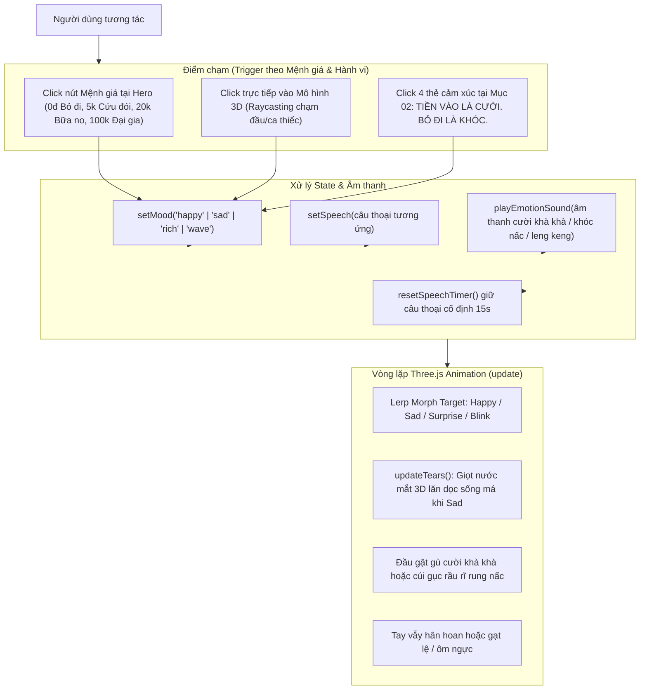

# Tài liệu Kỹ thuật: Nâng cấp Mô hình 3D & Hệ thống Biểu cảm "Chạm Một Cái, Ông Diễn Liền"

---

## 1. Mục đích
- **Nâng cấp thẩm mỹ mô hình 3D:** Khắc phục tình trạng mô hình 3D ban đầu bị thô, phần tóc và râu trước đó bị nhiễu hạt (static noise/dây gai tua tủa do sinh ngẫu nhiên 28.000 Catmull-Rom curves trên CPU gây giật lag và xấu), phần chân bị biến dạng thành các ống cong lơ lửng, khuôn mặt thiếu biểu cảm và tông da tái màu.
- **Hiện thực hóa trọn vẹn yêu cầu cảm xúc gắn liền với Số tiền & Hành động (Tiền vào là cười, Bỏ đi là khóc):**
  - **Loại bỏ icon/emoji:** Tuyệt đối không dùng các biểu tượng emoji lòe loẹt (`😄`, `😭`, `✨`) để giữ trọn vẹn phong cách retro bìa các-tông đường phố bụi bặm, chân thực.
  - **Liên kết cảm xúc theo số tiền cho/hành động:**
    - **0đ - BỎ ĐI THẬT À... (Khóc):** Khi người đi ngang quay lưng bỏ đi hoặc cho 0đ, ông nhíu mày số 8 đau xót, khóe miệng trĩu sâu mếu máo, đầu cúi gục rầu rĩ nấc từng cơn và **giọt nước mắt 3D (3D Animated Tears)** ròng ròng tuôn rơi từ khóe mắt xuống hai bên gò má.
    - **5.000đ - CỨU ĐÓI (Cười):** Đủ gói xôi sáng, ông cười mỉm ấm áp, gò má phúng phính nâng cao, mắt híp lại hình bán nguyệt.
    - **20.000đ - BỮA NO (Cười lớn):** Đủ đĩa cơm bình dân ấm bụng, ông cười tươi rạng rỡ, đầu gật gù rung lắc khà khà, tay nâng ca thiếc reo mừng.
    - **100.000đ - ĐẠI GIA (Hết hồn/Vui sướng):** Ông kinh ngạc trợn tròn mắt, hai má ửng hồng hớn hở, tay vẫy chào rối rít cảm tạ ân nhân.
  - **Chạm một cái, ông diễn liền:** Hỗ trợ tương tác trực tiếp bằng Raycasting khi người dùng click/chạm vào ông trên Canvas 3D (chạm đầu -> nhột cười tít mắt, chạm chiếc ca -> kêu leng keng cảm ơn), kết hợp thanh công cụ cảm xúc theo mệnh giá tại Hero và 4 thẻ cảm xúc chi tiết tại Mục 02.

---

## 2. Cấu trúc File & Thành phần liên quan

```text
src/
├── character/
│   ├── head.ts            # Tải mesh LeePerrySmith, tinh chỉnh morph targets (Happy, Sad, Surprise, Blink) & hệ thống hạt nước mắt 3D
│   ├── materials.ts       # Định nghĩa vật liệu da (subsurface scattering), tóc hoa râm, vải áo sờn, ca thiếc rỉ sét, và nước mắt khúc xạ trong suốt
│   └── createBeggar.ts    # Lắp ráp toàn bộ nhân vật 3D: tóc râu nghệ thuật, dáng ngồi xếp bằng vững chãi, khớp cử động tay, áo bà ba phủ kín lap, vòng lặp update animation
├── Beggar.tsx             # Component React bao bọc Three.js Canvas: WebGLRenderer, ánh sáng studio, bóng đổ mềm, Raycaster chạm trực tiếp
├── App.tsx                # Giao diện chính: thanh công cụ cảm xúc nhanh tại Hero, hệ thống âm thanh Web Audio (tiếng cười, tiếng khóc, tiếng keng), Mục 02 tương tác
└── index.css              # Styling Tailwind & CSS cho các thẻ cảm xúc, toolbar, bong bóng thoại

tests/
└── beggar.spec.ts         # Bộ kiểm thử tự động Playwright kiểm tra luồng cảm xúc, hiển thị 3D và tương tác chạm
```

---

## 3. Luồng hoạt động (Data Flow & UI Flow)



### Chi tiết luồng xử lý:
1. **Khởi tạo:**
   - `Beggar.tsx` dựng Canvas Three.js duy nhất thông qua `useEffect([], [])` với `useRef` lưu `onInteract` và `currentMood`, ngăn chặn việc tái tạo WebGL context khi re-render.
   - `createHead()` tính toán trước các mảng morph target cho các đỉnh khuôn mặt (x, y, z displacement theo hàm Gaussian tập trung chính xác vào khóe miệng, khóe mắt, nhân trung, chân mày, cằm).
2. **Kích hoạt cảm xúc (Cười / Khóc / Chạm):**
   - Khi bấm CƯỜI / KHÓC hoặc chạm trực tiếp, state `mood` được cập nhật.
   - Hàm `playEmotionSound` dùng Web Audio API tổng hợp âm sắc riêng biệt:
     - **Cười:** Chuỗi 4 nốt arpeggio tam giác vui tươi, nảy như tiếng khà khà.
     - **Khóc:** Chuỗi 3 nốt sin trầm buồn hạ dần tần số có độ rung vibrato nhẹ như tiếng thở dài nấc nghẹn.
     - **Chiếc ca:** Tiếng chuông kim loại cao vút (2200Hz - 4400Hz).
   - `resetSpeechTimer()` huỷ bỏ bộ hẹn giờ ngẫu nhiên và giữ câu thoại cảm xúc trong 15 giây.
3. **Diễn hoạt 3D (Render Loop):**
   - `update(time, mood, mouseX, mouseY)` tính toán hệ số chuyển động mềm mượt bằng `MathUtils.lerp`.
   - Khi `mood === 'happy'`: Khóe miệng mở rộng nâng cao, gò má phồng tròn, đầu gật gù nhịp $9.5Hz$, tay nâng ca thiếc lắc mừng.
   - Khi `mood === 'sad'`: Lông mày hình chữ bát dựng cao, miệng trĩu sâu mếu máo, đầu cúi thấp $0.32rad$ rung bần bật $16Hz$, vai nấc nhịp $2.8Hz$, và hàm `updateTears()` điều phối các giọt nước mắt 3D lấp lánh trượt dài từ mi mắt xuống cằm.

---

## 4. Lưu ý cho người bảo trì & mở rộng

- **Hiệu năng 3D:** Không tạo lại hình học (BufferGeometry) hoặc đường cong (CatmullRomCurve3) trong hàm `render()`. Mọi phép biến hình khuôn mặt phải dùng `morphTargetInfluences` để GPU xử lý tối ưu 60fps.
- **Dependency trong React:** Trong `Beggar.tsx`, `useEffect` tạo Three.js scene phải luôn có dependency array rỗng `[]`. Nếu cần truyền hàm callback từ component cha (như `onInteract`), luôn dùng `useRef` để giữ tham chiếu (`onInteractRef.current = onInteract`).
- **Thử nghiệm tự động:** File test `tests/beggar.spec.ts` dùng Playwright để xác thực tự động cả 3 kịch bản: Hero emotion toolbar, Section 02 reaction cards, và Raycaster chạm canvas.
